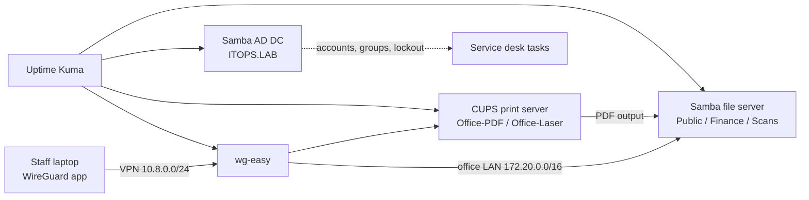
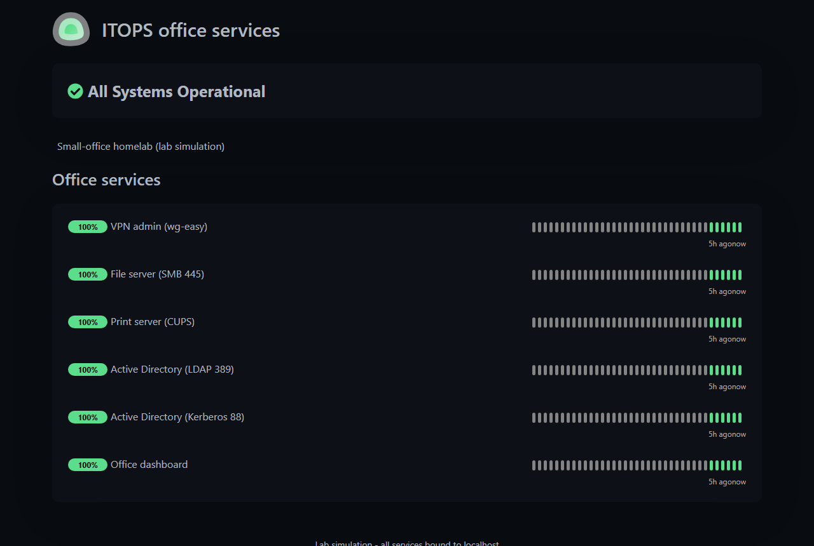

# IT Support Homelab

I built a simulated small office where staff connect remotely, share files and print, then documented how I diagnose and repair interruptions to those services.


[Configuration](docker-compose.yml) · [Recorded test results](docs/homelab-results.md)

## At a glance

| Area | Evidence-backed summary |
| --- | --- |
| **The problem** | In this simulated office, remote staff can connect to the VPN but still lose access to shared work; new starters can be denied Finance files and a paused print queue can stop the office printing, costing staff and support time. |
| **What I built** | I built the VPN, file and print services, directory administration, monitoring and office dashboard. I reproduced support faults, diagnosed them and recorded the repairs. |
| **Results** | [Homelab and directory checks reported zero failures; all 3 support cases were reproduced and repaired](docs/homelab-results.md). These are recorded lab results, not customer service metrics. |
| **Skills shown** | Service desk, troubleshooting, Docker, WireGuard, Samba Active Directory, file permissions, CUPS, PowerShell, monitoring and technical documentation. |
| **Relevant roles** | Service Desk Analyst, Desktop Support, IT Support Technician, Junior Systems Administrator. |
| **How it was built** | Designed, specified and reviewed by me; built with Codex as my coding agent (vibe coding). Verification and its limits are linked below. |
| **Try it / evidence** | [Dashboard](docs/img/dashboard.png) · [Runbook](docs/homelab-runbook.md) · [Results and transcripts](docs/homelab-results.md) · [Run it](#run-it) |

## What I did, step by step

1. Mapped a small office to remote access, shared files and printing, then isolated the services with [Docker Compose](docker-compose.yml).
2. Configured per-device VPN access and department share permissions; checked both permitted and denied operations.
3. Set up the PDF print queue and directory account tasks, with [runbook procedures](docs/homelab-runbook.md) for handover.
4. Added monitoring and a dashboard so an operator could see service status before investigating a ticket.
5. Injected routing, group-membership and print-queue faults, then captured diagnosis, repair and verification in the [worked cases](#worked-support-cases).
6. Ran the support and directory checks and published the [redacted transcripts](docs/evidence/).

## Problems I hit and how I solved them

- **VPN administration rejected the password hash:** corrected parsing of Windows line endings and verified login. [Build record](docs/homelab-results.md#problems-solved-while-building-it).
- **Samba AD could not store Windows ACLs in the container:** switched to the supported xattr TDB backend and checked SYSVOL ACLs. [Build record](docs/homelab-results.md#problems-solved-while-building-it).
- **A VPN handshake did not mean files were reachable:** traced the missing office route, corrected AllowedIPs and verified authenticated share access. [Worked ticket](docs/cases/01-vpn-shares.md).

## Start here

| If you want to see… | Open |
|---|---|
| How I troubleshoot a ticket | [VPN connects but shares won't open](docs/cases/01-vpn-shares.md), [new Finance starter gets "Access denied"](docs/cases/02-finance-starter.md), [whole office can't print](docs/cases/03-office-printing.md) |
| How I'd hand the environment to another engineer | [Runbook](docs/homelab-runbook.md): onboarding, offboarding, lost device, restore a file, clear a stuck queue, monitoring, backups |
| What end users are told | [User guides](docs/user-guides/): VPN, file shares, printing, password and MFA, Wi-Fi, email, onboarding |
| Proof it works | [Test results](docs/homelab-results.md) and redacted [transcripts](docs/evidence/) |

## The labs

| Lab | Built with | What I configured and tested |
|---|---|---|
| **VPN lab** | WireGuard (wg-easy) | Create, list and revoke per-device peers through the admin API; split-tunnel routes to the office LAN (172.20.0.0/16); a real WireGuard client container connects and reaches the file server through the tunnel |
| **File server & storage** | Samba | Public, Finance and Scans shares with group-based permissions: Finance staff can write to Finance, other staff are denied, everyone can use Public; Scans receives print-to-PDF output |
| **Print server** | CUPS | Two queues (Office-PDF prints real PDFs into Scans, Office-Laser simulates a network laser), public queue views, password-protected admin, test pages verified to complete |
| **Directory** | Samba 4 AD DC, domain `ITOPS.LAB` | OUs, users and groups; create user, reset password with change at next logon, account lockout after bad passwords and unlock, add to a group, disable a leaver |
| **Monitoring** | Uptime Kuma | Six monitors (VPN admin, SMB 445, CUPS, LDAP 389, Kerberos 88, dashboard) and a status page, created by a setup script |
| **Office dashboard** | Homepage | One page with live up/down status, VPN device count, uptime summary and links to every admin console and runbook |



## Dashboards

| Page | Local URL | What it shows |
|---|---|---|
| Office dashboard | http://127.0.0.1:13002 | Every service at a glance (screenshot above) |
| Status page | http://127.0.0.1:13001/status/office | Uptime history for each service |
| VPN admin | http://127.0.0.1:51821 | Devices, profiles and QR codes; create or revoke a device |
| Print server | http://127.0.0.1:6631/printers/ | Queues, jobs and printer administration |

 

## Worked support cases

Each fault was injected for real, diagnosed with real commands and fixed. The case write-ups are generated from the
captured output (`tests/reproduce_cases.py`):

1. **VPN connects but shares won't open.** The tunnel was up, but the saved profile was missing the office route. Proved it with `ip route get` and an `smbclient` failure, then corrected AllowedIPs and verified the route through `wg0`.
2. **New Finance starter: "Access denied".** Public worked but Finance was denied. Compared the user's groups with the share's permissions, added them to the finance group after (simulated) manager approval without widening the share, and confirmed write, read-back and delete.
3. **Whole office can't print.** Both queues were left paused after maintenance. Found it with `lpstat`, re-enabled the queues and accepted jobs, and confirmed the original stuck job completed.

## Run it

Requires Docker Desktop and Windows PowerShell 5.1 (Python 3 for the case reproductions).

```powershell
copy .env.example .env
powershell -NoProfile -File homelab/bootstrap.ps1     # generates all lab passwords privately
docker compose up -d --build
docker compose exec -T -e KUMA_PASSWORD=<KUMA_ADMIN_PASSWORD from .env> uptime node /lab/setup-kuma.js   # monitors + status page
python homelab/vpn/demo-peers.py                     # optional: three demo device profiles
powershell -NoProfile -File tests/homelab_check.ps1   # shares, permissions, printing, VPN peers, monitors, dashboard
powershell -NoProfile -File tests/ad_tasks.ps1        # directory service desk tasks
docker build -t it-support-homelab-vpn-client:14 homelab/vpn
python tests/reproduce_cases.py                       # breaks and fixes the three faults, then cleans up
```

[Recorded run (6 October 2026)](docs/homelab-results.md): homelab checks **0 failures**, AD tasks **0 failures**, all three cases reproduced, fixed and cleaned up.

## Honest limits

- The directory is **Samba AD**, not Windows Server: no RSAT, Group Policy or Windows domain join is demonstrated, and the file server's accounts are separate from AD.
- Office-Laser is a simulated printer. Office-PDF produces real PDFs.
- The VPN is tested with a real WireGuard client inside Docker. There's no public endpoint, MFA or production deployment.
- Backups and shadow copies are documented in the runbook as procedures, not scheduled jobs.

## Related project

[IT Ops Lab](https://github.com/iamnajib71/it-ops-lab) is an AI service-desk copilot (n8n, hybrid RAG, rule-based approval gate)
that answers tickets about this same office using the same user guides.

## Built by Nazmul Hassan

[LinkedIn](https://www.linkedin.com/in/iamnajib71) · [GitHub](https://github.com/iamnajib71)
